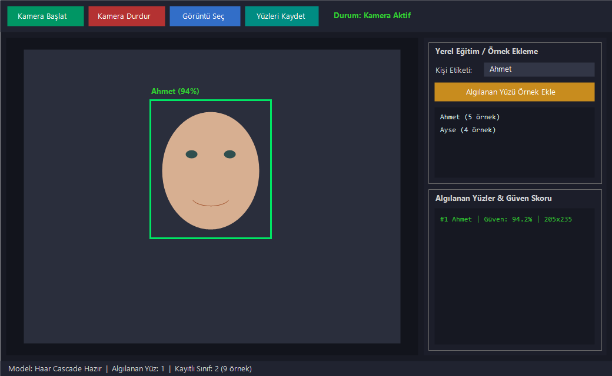
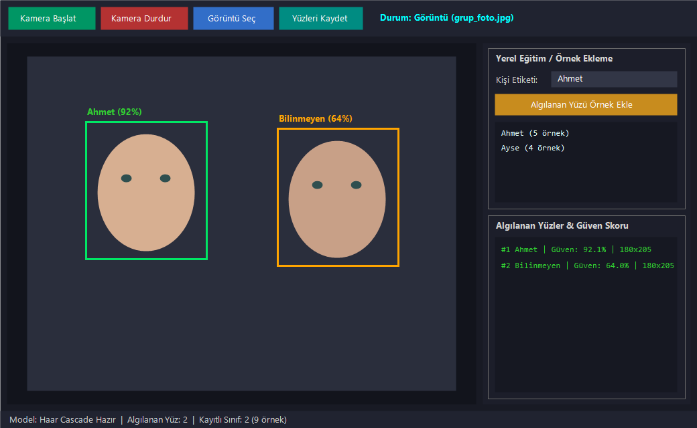

# YMH 219 - OpenCV ile Yüz Algılama ve Tanıma (FaceRecognition)

**Ders:** YMH 219 - Nesne Tabanlı Programlama (C# .NET 8.0 WinForms)  
**Geliştirici:** [agumusfu](https://github.com/agumusfu)

---

## Proje Hakkında

Bu proje, **OpenCvSharp4** kütüphanesi kullanılarak kameradan veya seçilen görüntü dosyalarından gerçek zamanlı yüz algılama ve yerel gönüllü örnek kümesi üzerinde yüz tanıma/etiketleme yapan bir Windows Forms masaüstü uygulamasıdır.

---

## Ekran Görüntüleri

### Canlı Kamera Üzerinden Yüz Algılama ve Tanıma


### Görüntü Dosyasından Çoklu Yüz Algılama & Güven Skoru


---

## Kullanılan Teknolojiler ve NuGet Paketleri

- **Platform:** C# / .NET 8.0 (`net8.0-windows`) Windows Forms
- **NuGet Paketleri:**
  - `OpenCvSharp4` (`4.10.0.20241108`)
  - `OpenCvSharp4.runtime.win` (`4.10.0.20241108`)
  - `OpenCvSharp4.Extensions` (`4.10.0.20241108`)
- **Algılama Modeli:** OpenCV Haar Cascade (`haarcascade_frontalface_default.xml`)

---

## Proje Yapısı

```text
YMH219-FaceRecognition/
├── .gitignore
├── README.md
├── docs/
│   └── screenshots/
│       ├── camera_detection.png
│       └── image_recognition.png
└── FaceRecognition/
    ├── FaceRecognition.csproj
    ├── app.ico
    ├── Program.cs
    ├── MainForm.cs
    ├── MainForm.Designer.cs
    ├── Models/
    │   ├── FaceDetectionResult.cs               # Algılanan yüz kutusu, etiket & güven skoru
    │   └── haarcascade_frontalface_default.xml  # Haar Cascade yüz algılama modeli
    └── Services/
        ├── FaceDetectorService.cs               # CascadeClassifier tabanlı çoklu yüz algılama
        └── FaceRecognizerService.cs             # Yerel örnek eğitimi ve Kosinüs benzerliği tanıma
```

---

## Temel Özellikler

- **Kamera ve Görüntü Desteği:** `Kamera Başlat` / `Kamera Durdur` ile canlı kamera akışı ve `Görüntü Seç` ile dosya üzerinden analiz.
- **Çoklu Yüz Algılama:** Aynı karedeki birden fazla yüzü eş zamanlı olarak dikdörtgen çerçeve ile işaretler.
- **Yerel Örnek Eğitimi & Tanıma:** Uygulama içindeki **Yerel Eğitim / Örnek Ekleme** panelinden kişi etiketi girip algılanan yüzü `%LocalAppData%\FaceRecognition\TrainingData\` altına kaydederek anlık tanıma modeli oluşturabilirsiniz.
- **Güven Skoru Gösterimi:** Tanınan her yüz için hem görüntü çerçevesi üzerinde hem de sağdaki sonuç listesinde yüzde güven skoru gösterilir.
- **Yüzleri Kaydetme:** `Yüzleri Kaydet` butonu ile karede algılanan tüm yüzler kırpılarak `%LocalAppData%\FaceRecognition\SavedFaces\` klasörüne kaydedilir.
- **Hata Yönetimi:** Kamera aygıtı bulunamadığında veya model dosyası yüklenemediğinde uygulama çökmeden kullanıcıya anlaşılır hata mesajı gösterir.

---

## Kurulum ve Çalıştırma

### Gereksinimler
- Windows 10/11
- [.NET 8.0 SDK](https://dotnet.microsoft.com/download/dotnet/8.0)

### Derleme ve Çalıştırma

```powershell
dotnet build FaceRecognition/FaceRecognition.csproj
dotnet run --project FaceRecognition/FaceRecognition.csproj
```

---

## Kapsam, Güvenlik Sınırı ve Geliştirme Notları

- Bu çalışma yalnızca ders kapsamında **yerel ve gönüllü örneklerle** çalışır; hiçbir görüntü ağ üzerinden gönderilmez veya uzaktan izleme amacıyla kullanılmaz.
- Yüz tanıma skoru, aydınlatma ve kamera açısına göre değişebilir; aynı kişi için farklı açılardan birkaç örnek eklemek tanıma doğruluğunu artırır.
